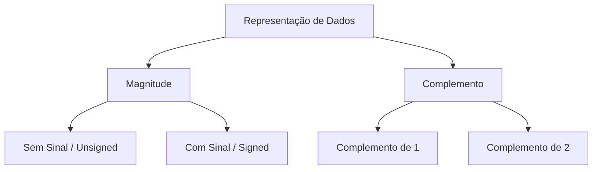

# Representação de Dados Inteiros

## Categorias de Representação



- **Sem Sinal**: Apenas números **positivos** ($\ge 0$).
- **Com Sinal / Complementos**: Permitem números **positivos e negativos**.

---

## Representação dos Números Positivos

::: {.callout-note}
## Regra Fundamental
Em todas as 4 categorias, os **números positivos** são representados exatamente da **mesma forma**.
:::

- Apenas a representação dos números **negativos** varia entre os métodos.

---

# Sinal e Magnitude (Signed Magnitude)

## Conceito e Bit de Sinal

- Adiciona um **bit extra (MSB)** à esquerda para indicar o sinal.
- **Bit de Sinal ($MSB$)**:
  - `0` $\rightarrow$ Número **Positivo** ($+$)
  - `1` $\rightarrow$ Número **Negativo** ($-$)
- Os bits restantes representam a **magnitude** (valor absoluto).

---

## Exemplo: Sinal e Magnitude

- **Sem Sinal (Unsigned)**:
  - $+6 = 110_2$
  - $-6 \rightarrow$ **Não pode** ser representado.

- **Com Sinal (Signed Magnitude)**:
  - $+6 = \mathbf{0}\,110_2$
  - $-6 = \mathbf{1}\,110_2$

---

## Alcance (Range) — Signed Magnitude

- Fórmula para $n$ bits:
  $$-\left(2^{n-1} - 1\right) \le X \le +\left(2^{n-1} - 1\right)$$

- **Exemplo para $n = 4$ bits**:
  $$-\left(2^{4-1} - 1\right) \text{ até } +\left(2^{4-1} - 1\right) \implies -7 \text{ até } +7$$

---

## Exercício 1: Signed Magnitude

::: {.callout-warning}
## Para Praticar (H.W.)
Represente os seguintes pares de números usando **Signed Magnitude**:

1. $+5$ e $-5$
2. $+9$ e $-9$
3. $+16$ e $-16$
:::

---

# Complemento de 1 (1's Complement)

## Regra de Formação

- Para obter o número negativo:
  1. Escreva o número em sua **forma positiva** (com bit de sinal `0`).
  2. Inverta **todos os bits** (troque `0` por `1` e `1` por `0`).

---

## Exemplos em Complemento de 1

::: {.columns}
::: {.column}
**Exemplo 1 ($n=4$ bits)**:
- $+6 = \mathbf{0}110_2$
- $-6 = \mathbf{1}001_2$
:::

::: {.column}
**Exemplo 2 ($n=5$ bits)**:
- $+9 = \mathbf{0}1001_2$
- $-9 = \mathbf{1}0110_2$
:::
:::

---

## O Problema do Zero em Complemento de 1

::: {.callout-danger}
## Ambiguidade do Zero
Existe dupla representação para o número **zero**:
:::

- $+0 = 0000_2$ (Zero Positivo)
- $-0 = 1111_2$ (Zero Negativo)

- Essa ambiguidade complica a implementação de circuitos aritméticos.

---

## Alcance (Range) — Complemento de 1

- Fórmula para $n$ bits:
  $$-\left(2^{n-1} - 1\right) \le X \le +\left(2^{n-1} - 1\right)$$

- **Exemplo para $n = 4$ bits**:
  $$-7 \text{ até } +7$$

---

## Exercício 2: Complemento de 1

::: {.callout-warning}
## Para Praticar (H.W.)
Represente os seguintes valores utilizando **Complemento de 1**:

1. $+10$ e $-10$
2. $+4$ e $-4$
3. $+23$ e $-23$
:::

---

# Complemento de 2 (2's Complement)

## Regra de Formação

- Para obter o número negativo:
  1. Escreva o número **positivo**.
  2. Aplique o **Complemento de 1** (inverta todos os bits).
  3. **Somar 1** ao resultado.

$$\text{2's Comp} = \text{1's Comp} + 1$$

---

## Exemplos em Complemento de 2

::: {.columns}
::: {.column}
**Representar $-6$ ($n=4$ bits)**:
- $+6 = 0110_2$
- 1's Comp: $1001_2$
- Somar $1$: $+ 1$
- $-6 = \mathbf{1010_2}$
:::

::: {.column}
**Representar $-4$ ($n=4$ bits)**:
- $+4 = 0100_2$
- 1's Comp: $1011_2$
- Somar $1$: $+ 1$
- $-4 = \mathbf{1100_2}$
:::
:::

---

## Unicidade do Zero em Complemento de 2

- **Zero Positivo**: $+0 = 0000_2$
- **Invertendo**: $1111_2$
- **Somando 1**: $1111_2 + 1 = 10000_2 \implies 0000_2$ (descartando o carry)

::: {.callout-success}
## Sem Ambiguidade
Existe **apenas uma representação para o zero** ($0000_2$).
:::

---

## Alcance (Range) — Complemento de 2

- Fórmula para $n$ bits:
  $$-2^{n-1} \le X \le +\left(2^{n-1} - 1\right)$$

- **Exemplo para $n = 4$ bits**:
  $$-2^{3} \text{ até } +(2^{3} - 1) \implies \mathbf{-8 \text{ até } +7}$$

---

## Distribuição dos Valores ($n=4$ bits)

| Categoria | Quantidade | Intervalo |
| :--- | :---: | :---: |
| Inteiros Negativos | 8 | $-8 \text{ a } -1$ |
| Zero | 1 | $0$ |
| Inteiros Positivos | 7 | $+1 \text{ a } +7$ |
| **Total** | **16** | **$2^4$ combinações** |

---

## Conversão de Negativo para Positivo

- O processo de **Complemento de 2 é reversível**:
  - Para encontrar o valor absoluto de $1011_2$ (que é negativo pois MSB = 1):

$$
\begin{aligned}
\text{Número Original (-5)}: & \quad 1011_2 \\
\text{1's Comp}: & \quad 0100_2 \\
\text{Somar 1}: & \quad + 1 \\
\text{Resultado (+5)}: & \quad \mathbf{0101_2}
\end{aligned}
$$

---

## Exercício 3: Complemento de 2

::: {.callout-warning}
## Para Praticar (H.W.)
1. Represente $+5$ e $-5$ em Complemento de 2.
2. Represente $-8$ em 4 bits.
3. Represente $+8$ e $-9$ em:
   - 4 bits (se possível)
   - 5 bits
:::

---

# Subtração em Complemento de 2

## Algoritmo de Subtração

- A subtração $A - B$ é convertida em uma adição:
  $$A - B = A + (-B)$$
  onde $-B$ é representado em **Complemento de 2**.

---

## Regras do Carry na Subtração

::: {.fragment}
- **Se gerar "Vai Um" (Carry Out = 1)**:
  - O resultado é **positivo**.
  - O resultado já está na forma direta (**True Form**).
  - **Desconsiderar** o bit de carry final.
:::

::: {.fragment}
- **Se NÃO gerar "Vai Um" (Carry Out = 0)**:
  - O resultado é **negativo**.
  - O resultado está em **Complemento de 2**.
:::

---

## Exemplo 1 de Subtração

Operação em 4 bits: $(0001)_2 - (1111)_2$  [em decimal: $1 - (-1)$]

- $A = 0001_2$
- $B = 1111_2 \implies -B = 0001_2$ (Complemento de 2 de $1111_2$)

$$
\begin{array}{r@{\quad}l}
0001_2 & (A) \\
+ \; 0001_2 & (-B) \\
\hline
\mathbf{0010_2} & (+2_{10})
\end{array}
$$

---

## Exemplo 2: Subtração e Análise

Operação em 4 bits: $(1001)_2 - (0100)_2$

- $A = 1001_2 = -7_{10}$
- $B = 0100_2 = +4_{10} \implies -B = 1100_2$

$$
\begin{array}{r@{\quad}l}
& 1001_2 \\
+ & 1100_2 \\
\hline
\mathbf{1} & \mathbf{0101_2} \quad (\text{Carry Out} = 1)
\end{array}
$$

- O resultado mantendo 4 bits seria $0101_2 = +5_{10}$.
- **Porém**: $-7 - 4 = -11_{10}$, que está **fora do alcance** de 4 bits ($-8 \text{ a } +7$).

---

# Overflow Aritmético

## O que é Overflow?

- Ocorre quando o resultado de uma operação aritmética **excede a capacidade** de representação de bits disponível.
- Exemplo: Adicionar dois números de 4 bits gerando um resultado que requer 5 bits válidos.

---

## Condição Lógica para Overflow

Sejam:
- $X$: bit de sinal do primeiro operando ($A$)
- $Y$: bit de sinal do segundo operando ($B$)
- $Z$: bit de sinal do resultado

$$V = \bar{X}\bar{Y}Z + XY\bar{Z}$$

- $V = 1 \implies$ **Ocorreu Overflow**
- $V = 0 \implies$ **Sem Overflow**

---

## Análise do Exemplo Anterior

Para a soma de $1001_2$ ($-7$) e $1100_2$ ($-4$):
- $X = 1$, $Y = 1$, $Z = 0$

$$
\begin{aligned}
V &= \bar{1} \cdot \bar{1} \cdot 0 + 1 \cdot 1 \cdot \bar{0} \\
V &= 0 \cdot 0 \cdot 0 + 1 \cdot 1 \cdot 1 \\
V &= \mathbf{1} \quad \text{(OVERFLOW!)}
\end{aligned}
$$

---

## Regra Prática de Overflow

::: {.callout-important}
## Regras de Sinal
1. **Soma de dois positivos** resultando em **negativo** $\implies$ **Overflow**.
2. **Soma de dois negativos** resultando em **positivo** $\implies$ **Overflow**.
3. **Operandos com sinais opostos** $\implies$ **NUNCA ocorre Overflow**.
:::

---

## Círculo Numérico (4 Bits)

```
              0000 (0)
        1111 (-1)   0001 (+1)
    1110 (-2)           0010 (+2)
  1101 (-3)               0011 (+3)
  1100 (-4)               0100 (+4)
    1011 (-5)           0101 (+5)
        1010 (-6)   0110 (+6)
              1001 (-7)
              1000 (-8)
```

- Transição no sentido horário ultrapassando $+7 \rightarrow -8$: **Overflow por Adição**.
- Transição no sentido anti-horário ultrapassando $-8 \rightarrow +7$: **Overflow por Subtração**.

---

## Exercício 4: Subtração

::: {.callout-warning}
## Para Praticar (H.W.)
Calcule as operações em Complemento de 2 (4 bits) e indique se ocorre overflow:

1. $(0110)_2 - (0100)_2$
2. $(0111)_2 - (1110)_2$
:::

---

# Multiplicação e Divisão em Binário

## Operações Sem Sinal (Unsigned)

- Seguem as mesmas técnicas da base decimal.
- **Multiplicação**: Soma de produtos parciais deslocados.
- **Divisão**: Subtrações sucessivas deslocadas.

---

## Exemplo: Multiplicação Sem Sinal

$$1100101_2 \times 111101_2 \quad (101_{10} \times 61_{10})$$

$$
\begin{array}{r@{\quad}l}
& 1100101 \\
\times & 111101 \\
\hline
& 1100101 \\
+ & 110010100 \\
+ & \dots \\
\hline
= & \mathbf{1100000010001_2} = 6161_{10}
\end{array}
$$

---

## Desafio em Complemento de 2

- Não é possível aplicar diretamente a técnica padrão para operandos negativos sem ajustes.
- **Estratégia Simplificada**:
  1. Converter os operandos para seus **valores absolutos**.
  2. Realizar a multiplicação ou divisão sem sinal.
  3. Negar o resultado se os **sinais originais forem diferentes**.
