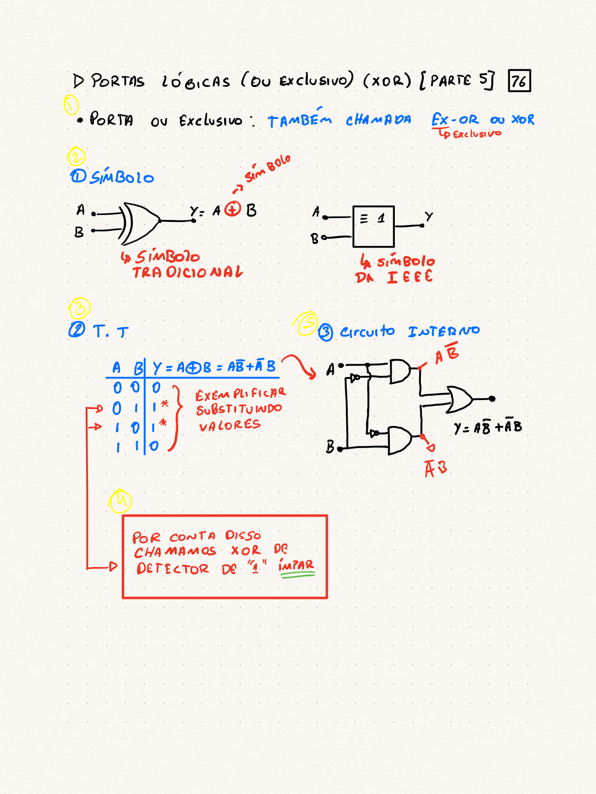

# Portas Lógicas: XOR (OU Exclusivo)

## Porta XOR: Definição e Expressão
- A **Porta OU Exclusivo (XOR)** é também conhecida como **EX-OR**.
- Sua saída é alta (1) apenas se o número de entradas altas for **ímpar**.
- **Expressão Booleana**: $Y = A \oplus B = A\bar{B} + \bar{A}B$

## Porta XOR: Símbolos Lógicos

::: {.columns}

::: {.column}
**Símbolo Tradicional**
```{mermaid}
flowchart LR
  A((A)) --> XOR[XOR]
  B((B)) --> XOR
  XOR --> Y((Y = A ⊕ B))
```
:::

::: {.column}
**Símbolo IEEE**
```{mermaid}
flowchart LR
  A((A)) --> IEEE["= 1"]
  B((B)) --> IEEE
  IEEE --> Y((Y))
```
:::

:::

## Porta XOR: Tabela-Verdade

::: {.fragment}
::: {.list-table}

- - $A$
  - $B$
  - $Y = A \oplus B$
- - 0
  - 0
  - 0
- - 0
  - 1
  - 1
- - 1
  - 0
  - 1
- - 1
  - 1
  - 0

:::
:::

## Demonstração Interativa: Porta XOR {data-fullscreen="true"}
<iframe src="../assets/global/simulador-logico.html?preset=gates&gate=XOR&hide=panels"></iframe>

## Porta XOR: Circuito Interno
- A porta XOR pode ser implementada usando portas AND, OR e NOT:

<!-- FIGURE: page-1 - Circuito interno da porta XOR (A.B' + A'.B) -->


## Porta XOR: Propriedade Chave
- A porta XOR é um **detector de "1" ímpar**.
- Sua saída é alta (1) se houver um número ímpar de entradas em nível lógico alto.

## Porta XOR: Propriedades (Parte 1)
- **Identidades com 0, 1, A, $\bar{A}$**:
  - $A \oplus A = 0$
  - $A \oplus \bar{A} = 1$
  - $A \oplus 0 = A$
  - $A \oplus 1 = \bar{A}$

## Porta XOR: Propriedades (Parte 2)
- **Associatividade e Comutatividade**:
  - A operação XOR é **comutativa**: $A \oplus B = B \oplus A$
  - A operação XOR é **associativa**:
