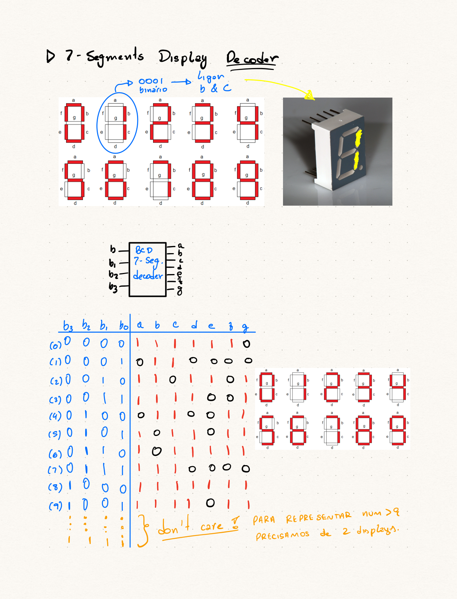

# Decodificador de Display de 7 Segmentos

## O que é um Display de 7 Segmentos?
- Dispositivo eletrônico para exibir **dígitos decimais** (0-9).
- Composto por **7 LEDs** individuais (segmentos `a` a `g`).
- Cada segmento pode ser ligado ou desligado para formar o dígito.

<!-- FIGURE: page-1 - Display de 7 segmentos físico e diagrama de segmentos -->
{width="60%"}

## Exemplo: Representando o Dígito '1'
- Para exibir o dígito **'1'**, apenas os segmentos **`b` e `c`** são ativados.
- A entrada binária `0001` (decimal 1) acende `b` e `c`.

## Decodificador BCD para 7 Segmentos
- Converte uma entrada **BCD (Binary-Coded Decimal)** de 4 bits.
- Gera as 7 saídas (`a` a `g`) para acionar os segmentos do display.

```{mermaid}
flowchart LR
  subgraph Entradas BCD
    b3((b3))
    b2((b2))
    b1((b1))
    b0((b0))
  end

  subgraph Decodificador 7-Seg
    b3 --> Decoder
    b2 --> Decoder
    b1 --> Decoder
    b0 --> Decoder
  end

  subgraph Saídas dos Segmentos
    Decoder --> a((a))
    Decoder --> b((b))
    Decoder --> c((c))
    Decoder --> d((d))
    Decoder --> e((e))
    Decoder --> f((f))
    Decoder --> g((g))
  end
```

## Tabela-Verdade: Entradas BCD e Saídas dos Segmentos {.smaller}
- Define quais segmentos devem acender para cada dígito decimal (0-9).
- As entradas binárias de 10 a 15 são **"Não Importa" (Don't Care)**.

::: {.fragment}
::: {.list-table}

- - **Decimal**
  - $b_3$
  - $b_2$
  - $b_1$
  - $b_0$
  - $a$
  - $b$
  - $c$
  - $d$
  - $e$
  - $f$
  - $g$
- - 0
  - 0
  - 0
  - 0
  - 0
  - 1
  - 1
  - 1
  - 1
  - 1
  - 1
  - 0
- - 1
  - 0
  - 0
  - 0
  - 1
  - 0
  - 1
  - 1
  - 0
  - 0
  - 0
  - 0
- - 2
  - 0
  - 0
  - 1
  - 0
  - 1
  - 1
  - 0
  - 1
  - 1
  - 0
  - 1
- - 3
  - 0
  - 0
  - 1
  - 1
  - 1
  - 1
  - 1
  - 1
  - 0
  - 0
  - 1
- - 4
  - 0
  - 1
  - 0
  - 0
  - 0
  - 1
  - 1
  - 0
  - 0
  - 1
  - 1
- - 5
  - 0
  - 1
  - 0
  - 1
  - 1
  - 0
  - 1
  - 1
  - 0
  - 1
  - 1
- - 6
  - 0
  - 1
  - 1
  - 0
  - 1
  - 0
  - 1
  - 1
  - 1
  - 1
  - 1
- - 7
  - 0
  - 1
  - 1
  - 1
  - 1
  - 1
  - 1
  - 0
  - 0
  - 0
  - 0
- - 8
  - 1
  - 0
  - 0
  - 0
  - 1
  - 1
  - 1
  - 1
  - 1
  - 1
  - 1
- - 9
  - 1
  - 0
  - 0
  - 1
  - 1
  - 1
  - 1
  - 1
  - 0
  - 1
  - 1
- - 10-15
  - X
  - X
  - X
  - X
  - X
  - X
  - X
  - X
  - X
  - X
  - X

:::
:::

## Representação Visual dos Dígitos
- A combinação dos segmentos `a` a `g` forma cada dígito.

<!-- FIGURE: page-1 - Dígitos 0-9 no display de 7 segmentos -->
{width="60%"}

## Nota Importante
::: {.callout-note}
## Números Maiores que 9
Para representar números maiores que 9, como 10, 11, etc., precisamos de **dois ou mais displays de 7 segmentos** conectados a decodificadores separados.
:::

# Simplificação dos Segmentos com Mapas de Karnaugh

## Segmento 'a'
- Mintermos: $m(0, 2, 3, 5, 6, 7, 8, 9)$
- Don't Cares: $d(10, 11, 12, 13, 14, 15)$
- Expressão Simplificada:
  $$a = b_3 + b_2 + b_1 \cdot b_0 + b_2 \cdot b_0$$

::: {.fragment}
## Mapa de Karnaugh Interativo {data-fullscreen="true"}
<iframe src="../assets/global/karnaugh.html?vars=4&m=0,2,3,5,6,7,8,9&d=10,11,12,13,14,15&names=b3,b2,b1,b0&hide=panels"></iframe>
:::

## Segmento 'b'
- Mintermos: $m(0, 1, 2, 3, 4, 7, 8, 9)$
- Don't Cares: $d(10, 11, 12, 13, 14, 15)$
- Expressão Simplificada:
  $$b = b_3 + b_2 + b_1 \cdot b_0 + b_1 \cdot \overline{b_0} \quad \Rightarrow \quad b = b_3 + b_2 + b_1$$

::: {.fragment}
## Mapa de Karnaugh Interativo {data-fullscreen="true"}
<iframe src="../assets/global/karnaugh.html?vars=4&m=0,1,2,3,4,7,8,9&d=10,11,12,13,14,15&names=b3,b2,b1,b0&hide=panels"></iframe>
:::

## Segmento 'c'
- Mintermos: $m(0, 1, 3, 4, 5, 6, 7, 8, 9)$
- Don't Cares: $d(10, 11, 12, 13, 14, 15)$
- Expressão Simplificada:
  $$c = b_3 + b_2 + b_1 + b_0$$

::: {.fragment}
## Mapa de Karnaugh Interativo {data-fullscreen="true"}
<iframe src="../assets/global/karnaugh.html?vars=4&m=0,1,3,4,5,6,7,8,9&d=10,11,12,13,14,15&names=b3,b2,b1,b0&hide=panels"></iframe>
:::

## Segmento 'd'
- Mintermos: $m(0, 2, 3, 5, 6, 8, 9)$
- Don't Cares: $d(10, 11, 12, 13, 14, 15)$
- Expressão Simplificada:
  $$d = b_3 + \overline{b_2} \cdot \overline{b_0} + b_1 \cdot \overline{b_0} + \overline{b_1} \cdot b_0$$

::: {.fragment}
## Mapa de Karnaugh Interativo {data-fullscreen="true"}
<iframe src="../assets/global/karnaugh.html?vars=4&m=0,2,3,5,6,8,9&d=10,11,12,13,14,15&names=b3,b2,b1,b0&hide=panels"></iframe>
:::

## Segmento 'e'
- Mintermos: $m(0, 2, 6, 8)$
- Don't Cares: $d(10, 11, 12, 13, 14, 15)$
- Expressão Simplificada:
  $$e = \overline{b_2} \cdot \overline{b_0} + b_1 \cdot \overline{b_0}$$

::: {.fragment}
## Mapa de Karnaugh Interativo {data-fullscreen="true"}
<iframe src="../assets/global/karnaugh.html?vars=4&m=0,2,6,8&d=10,11,12,13,14,15&names=b3,b2,b1,b0&hide=panels"></iframe>
:::

## Segmento 'f'
- Mintermos: $m(0, 4, 5, 6, 8, 9)$
- Don't Cares: $d(10, 11, 12, 13, 14, 15)$
- Expressão Simplificada:
  $$f = b_3 + b_2 \cdot \overline{b_1} + b_2 \cdot \overline{b_0}$$

::: {.fragment}
## Mapa de Karnaugh Interativo {data-fullscreen="true"}
<iframe src="../assets/global/karnaugh.html?vars=4&m=0,4,5,6,8,9&d=10,11,12,13,14,15&names=b3,b2,b1,b0&hide=panels"></iframe>
:::

## Segmento 'g'
- Mintermos: $m(2, 3, 4, 5, 6, 8, 9)$
- Don't Cares: $d(10, 11, 12, 13, 14, 15)$
- Expressão Simplificada:
  $$g = b_3 + b_1 \cdot \overline{b_0} + \overline{b_2} \cdot b_1$$

::: {.fragment}
## Mapa de Karnaugh Interativo {data-fullscreen="true"}
<iframe src="../assets/global/karnaugh.html?vars=4&m=2,3,4,5,6,8,9&d=10,11,12,13,14,15&names=b3,b2,b1,b0&hide=panels"></iframe>
:::
