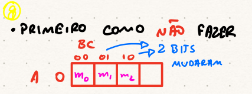
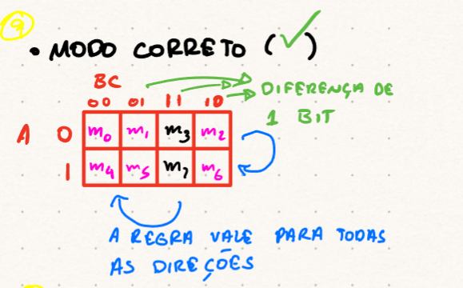

# Mapas de Karnaugh (K-Map)
## Introdução à Minimização
-   Estudamos inicialmente a minimização de expressões usando **Álgebra Booleana**.
-   O objetivo é sempre obter um resultado **MÍNIMO** para a função lógica.

::: {.fragment}
::: {.callout-note}
## Limitação da Álgebra Booleana
Para funções com muitas variáveis, a simplificação algébrica pode ser complexa e nem sempre garante a forma mais mínima.
:::
:::

## Exemplo: Função F(A,B,C)
-   Vamos iniciar com a função e sua Tabela-Verdade:
    $$F = A + B\bar{C}$$

## Tabela-Verdade de F(A,B,C)
::: {.fragment}
::: {.list-table}
-   - $A$
    - $B$
    - $C$
    - $F$
-   - 0
    - 0
    - 0
    - 0
-   - 0
    - 0
    - 1
    - 0
-   - 0
    - 1
    - 0
    - 1
-   - 0
    - 1
    - 1
    - 0
-   - 1
    - 0
    - 0
    - 1
-   - 1
    - 0
    - 1
    - 1
-   - 1
    - 1
    - 0
    - 1
-   - 1
    - 1
    - 1
    - 1
:::
:::

## Forma Canônica SOP (Soma de Produtos)
-   A partir da Tabela-Verdade, identificamos os mintermos onde $F=1$:
    $$F(A,B,C) = \Sigma m(2,4,5,6,7)$$
-   Expandindo:
    $$F = \bar{A}B\bar{C} + A\bar{B}\bar{C} + A\bar{B}C + AB\bar{C} + ABC$$

## Simplificação Algébrica {.smaller}

::: {.columns}

::: {.column}

$$
\begin{aligned}
F &= \bar{A}B\bar{C} + A\bar{B}\bar{C} + A\bar{B}C + AB\bar{C} + ABC \\
&= \bar{A}B\bar{C} + A(\bar{B}\bar{C} + \bar{B}C + B\bar{C} + BC) \\
&= \bar{A}B\bar{C} + A(\bar{B}(\bar{C}+C) + B(\bar{C}+C)) \\
&= \bar{A}B\bar{C} + A(\bar{B}(1) + B(1)) \\
&= \bar{A}B\bar{C} + A(\bar{B} + B) \\
&= \bar{A}B\bar{C} + A(1) \\
&= A + \bar{A}B\bar{C}
\end{aligned}
$$

:::

::: {.column .callout-tip .fragment}

## Identidade Útil
Lembre-se da identidade: $X + \bar{X}Y = X+Y$.
Aplicando-a, $A + \bar{A}(B\bar{C}) = A + B\bar{C}$.

:::

:::

## K-Map: Representação Visual
-   O K-Map organiza as células da Tabela-Verdade de forma que células adjacentes diferem em apenas **um bit**.
-   Isso permite a simplificação visual de expressões lógicas.

## Mapeamento da Tabela-Verdade
-   Cada linha da Tabela-Verdade corresponde a uma célula no K-Map.

## Tabela-Verdade com Mintermos {.smaller}
::: {.list-table}
-   - $A$
    - $B$
    - $C$
    - $F$
    - Mintermo
-   - 0
    - 0
    - 0
    - 0
    - $m_0$
-   - 0
    - 0
    - 1
    - 0
    - $m_1$
-   - 0
    - 1
    - 0
    - 1
    - $m_2$
-   - 0
    - 1
    - 1
    - 0
    - $m_3$
-   - 1
    - 0
    - 0
    - 1
    - $m_4$
-   - 1
    - 0
    - 1
    - 1
    - $m_5$
-   - 1
    - 1
    - 0
    - 1
    - $m_6$
-   - 1
    - 1
    - 1
    - 1
    - $m_7$
:::

## Estrutura do K-Map (3 Variáveis) {.smaller}
-   As variáveis são organizadas usando o **Código Gray** para garantir que células adjacentes (incluindo as que "enrolam" nas bordas) difiram em apenas 1 bit.

::: {.columns}
::: {.column .fragment}

**Ordem Incorreta (NÃO FAZER)**
- Usa ordem binária sequencial.
- Células adjacentes podem diferir em mais de 1 bit.

:::
::: {.column .fragment}

{width="80%"}

:::
:::

## Estrutura do K-Map (3 Variáveis) {.smaller}
-   As variáveis são organizadas usando o **Código Gray** para garantir que células adjacentes (incluindo as que "enrolam" nas bordas) difiram em apenas 1 bit.

::: {.columns}

::: {.column .fragment}

**Ordem Correta (Código Gray)**
- Garante que adjacências (horizontal, vertical, e "enrolando") diferem em 1 bit.

:::

::: {.column .fragment}

{width="80%"}

:::

:::

## Por que Código Gray?
-   A diferença de 1 bit entre células adjacentes é crucial para a simplificação.
-   Permite aplicar a propriedade da Álgebra Booleana:
    $$X\bar{Y} + XY = X( \bar{Y} + Y ) = X(1) = X$$
-   Isso elimina a variável que muda de valor entre as células agrupadas.

# Construindo um K-Map

## Etapas para Simplificação {.smaller}
1.  **Criar o Mapa**: Desenhe a grade do K-Map com as variáveis organizadas em Código Gray.
2.  **Preencher o Mapa**: Coloque '1' nas células correspondentes aos mintermos da função e '0' nas demais.
3.  **Fazer Pareamento (Agrupamento)**: Agrupe os '1's em potências de 2 ($2^n$, ou seja, 1, 2, 4, 8, 16, etc.).
4.  **Maximizar Agrupamentos**: Tente parear a maior quantidade possível de '1's primeiro (8s, depois 4s, depois 2s, e por último 1s isolados).
5.  **Regras de Agrupamento**:
    -   Só podemos agrupar na **horizontal** e **vertical**.
    -   O pareamento pode se **sobrepor**.
    -   Todos os '1's devem ser cobertos por pelo menos um grupo.

## Estrutura da Grade (3 Variáveis) {.smaller}
- $2^3 = 8$ células organizadas em uma matriz $2 \times 4$:
  - Linhas: variável $A \in \{0, 1\}$
  - Colunas: variáveis $BC \in \{00, 01, 11, 10\}$ (Código Gray)

::: {.fragment}

  <table style="border-collapse: separate; border-spacing: 8px; width: 100%; font-family: 'JetBrains Mono', monospace; text-align: center; border: none; background: transparent;">
    <thead>
      <tr>
        <th style="background: transparent; border: none; color: #6D28D9; font-weight: 800; font-size: 1.05em; width: 20%; padding: 8px;">A \ BC</th>
        <th style="background: #EDE9FE; color: #4C1D95; border: 1px solid #DDD6FE; border-radius: 8px; font-weight: 700; width: 20%; padding: 8px;">00</th>
        <th style="background: #EDE9FE; color: #4C1D95; border: 1px solid #DDD6FE; border-radius: 8px; font-weight: 700; width: 20%; padding: 8px;">01</th>
        <th style="background: #EDE9FE; color: #4C1D95; border: 1px solid #DDD6FE; border-radius: 8px; font-weight: 700; width: 20%; padding: 8px;">11</th>
        <th style="background: #EDE9FE; color: #4C1D95; border: 1px solid #DDD6FE; border-radius: 8px; font-weight: 700; width: 20%; padding: 8px;">10</th>
      </tr>
    </thead>
    <tbody>
      <tr>
        <td style="background: #EDE9FE; color: #4C1D95; border: 1px solid #DDD6FE; border-radius: 8px; font-weight: 700; padding: 10px;">0</td>
        <td style="background: #F8FAFC; border: 1px solid #CBD5E1; border-radius: 8px; padding: 10px; font-weight: 600; color: #334155;">m₀ (000)</td>
        <td style="background: #F8FAFC; border: 1px solid #CBD5E1; border-radius: 8px; padding: 10px; font-weight: 600; color: #334155;">m₁ (001)</td>
        <td style="background: #F8FAFC; border: 1px solid #CBD5E1; border-radius: 8px; padding: 10px; font-weight: 600; color: #334155;">m₃ (011)</td>
        <td style="background: #F8FAFC; border: 1px solid #CBD5E1; border-radius: 8px; padding: 10px; font-weight: 600; color: #334155;">m₂ (010)</td>
      </tr>
      <tr>
        <td style="background: #EDE9FE; color: #4C1D95; border: 1px solid #DDD6FE; border-radius: 8px; font-weight: 700; padding: 10px;">1</td>
        <td style="background: #F8FAFC; border: 1px solid #CBD5E1; border-radius: 8px; padding: 10px; font-weight: 600; color: #334155;">m₄ (100)</td>
        <td style="background: #F8FAFC; border: 1px solid #CBD5E1; border-radius: 8px; padding: 10px; font-weight: 600; color: #334155;">m₅ (101)</td>
        <td style="background: #F8FAFC; border: 1px solid #CBD5E1; border-radius: 8px; padding: 10px; font-weight: 600; color: #334155;">m₇ (111)</td>
        <td style="background: #F8FAFC; border: 1px solid #CBD5E1; border-radius: 8px; padding: 10px; font-weight: 600; color: #334155;">m₆ (110)</td>
      </tr>
    </tbody>
  </table>

::: 

::: {.callout-note .fragment}
Atenção à troca de posição entre a 3ª e a 4ª coluna: $11$ vem antes de $10$ para manter a diferença de apenas 1 bit!
:::

## Preenchimento da Função: $F(A,B,C)$
- Função do exemplo: $F(A,B,C) = \Sigma m(2, 4, 5, 6, 7)$
- Células com **'1'**: $m_2, m_4, m_5, m_6, m_7$
- Células com **'0'**: $m_0, m_1, m_3$

  <table style="border-collapse: separate; border-spacing: 8px; width: 100%; font-family: 'JetBrains Mono', monospace; text-align: center; border: none; background: transparent;">
    <thead>
      <tr>
        <th style="background: transparent; border: none; color: #6D28D9; font-weight: 800; font-size: 1.05em; width: 20%; padding: 8px;">A \ BC</th>
        <th style="background: #EDE9FE; color: #4C1D95; border: 1px solid #DDD6FE; border-radius: 8px; font-weight: 700; width: 20%; padding: 8px;">00</th>
        <th style="background: #EDE9FE; color: #4C1D95; border: 1px solid #DDD6FE; border-radius: 8px; font-weight: 700; width: 20%; padding: 8px;">01</th>
        <th style="background: #EDE9FE; color: #4C1D95; border: 1px solid #DDD6FE; border-radius: 8px; font-weight: 700; width: 20%; padding: 8px;">11</th>
        <th style="background: #EDE9FE; color: #4C1D95; border: 1px solid #DDD6FE; border-radius: 8px; font-weight: 700; width: 20%; padding: 8px;">10</th>
      </tr>
    </thead>
    <tbody>
      <tr>
        <td style="background: #EDE9FE; color: #4C1D95; border: 1px solid #DDD6FE; border-radius: 8px; font-weight: 700; padding: 12px;">0</td>
        <td style="background: #F8FAFC; border: 1px solid #E2E8F0; border-radius: 8px; padding: 12px; position: relative;">
          0
          m₀
        </td>
        <td style="background: #F8FAFC; border: 1px solid #E2E8F0; border-radius: 8px; padding: 12px; position: relative;">
          0
          m₁
        </td>
        <td style="background: #F8FAFC; border: 1px solid #E2E8F0; border-radius: 8px; padding: 12px; position: relative;">
          0
          m₃
        </td>
        <td style="background: #F8FAFC; border: 1px solid #CBD5E1; border-radius: 8px; padding: 12px; position: relative;">
          1
          m₂
        </td>
      </tr>
      <tr>
        <td style="background: #EDE9FE; color: #4C1D95; border: 1px solid #DDD6FE; border-radius: 8px; font-weight: 700; padding: 12px;">1</td>
        <td style="background: #F8FAFC; border: 1px solid #CBD5E1; border-radius: 8px; padding: 12px; position: relative;">
          1
          m₄
        </td>
        <td style="background: #F8FAFC; border: 1px solid #CBD5E1; border-radius: 8px; padding: 12px; position: relative;">
          1
          m₅
        </td>
        <td style="background: #F8FAFC; border: 1px solid #CBD5E1; border-radius: 8px; padding: 12px; position: relative;">
          1
          m₇
        </td>
        <td style="background: #F8FAFC; border: 1px solid #CBD5E1; border-radius: 8px; padding: 12px; position: relative;">
          1
          m₆
        </td>
      </tr>
    </tbody>
  </table>

## Agrupamentos com Cores Highlight {.smaller}
- Pareamento de **maior tamanho possível** ($2^n$) com sobreposição:

  <table style="border-collapse: separate; border-spacing: 8px; width: 100%; font-family: 'JetBrains Mono', monospace; text-align: center; border: none; background: transparent;">
    <thead>
      <tr>
        <th style="background: transparent; border: none; color: #6D28D9; font-weight: 800; font-size: 1.05em; width: 20%; padding: 6px;">A \ BC</th>
        <th style="background: #EDE9FE; color: #4C1D95; border: 1px solid #DDD6FE; border-radius: 8px; font-weight: 700; width: 20%; padding: 6px;">00</th>
        <th style="background: #EDE9FE; color: #4C1D95; border: 1px solid #DDD6FE; border-radius: 8px; font-weight: 700; width: 20%; padding: 6px;">01</th>
        <th style="background: #EDE9FE; color: #4C1D95; border: 1px solid #DDD6FE; border-radius: 8px; font-weight: 700; width: 20%; padding: 6px;">11</th>
        <th style="background: #EDE9FE; color: #4C1D95; border: 1px solid #DDD6FE; border-radius: 8px; font-weight: 700; width: 20%; padding: 6px;">10</th>
      </tr>
    </thead>
    <tbody>
      <tr>
        <td style="background: #EDE9FE; color: #4C1D95; border: 1px solid #DDD6FE; border-radius: 8px; font-weight: 700; padding: 10px;">0</td>
        <!-- m0 -->
        <td style="background: #F8FAFC; border: 1px solid #E2E8F0; border-radius: 8px; padding: 10px; position: relative;">
          0
          m₀
        </td>
        <!-- m1 -->
        <td style="background: #F8FAFC; border: 1px solid #E2E8F0; border-radius: 8px; padding: 10px; position: relative;">
          0
          m₁
        </td>
        <!-- m3 -->
        <td style="background: #F8FAFC; border: 1px solid #E2E8F0; border-radius: 8px; padding: 10px; position: relative;">
          0
          m₃
        </td>
        <!-- m2 (Grupo II - Rosa) -->
        <td style="background: rgba(244, 63, 94, 0.22); border: 2.5px solid #F43F5E; border-radius: 8px; padding: 10px; position: relative; box-shadow: 0 0 12px rgba(244, 63, 94, 0.35);">
          1
          m₂
        </td>
      </tr>
      <tr>
        <td style="background: #EDE9FE; color: #4C1D95; border: 1px solid #DDD6FE; border-radius: 8px; font-weight: 700; padding: 10px;">1</td>
        <!-- m4 (Grupo I - Verde Esmeralda) -->
        <td style="background: rgba(16, 185, 129, 0.22); border: 2.5px solid #10B981; border-radius: 8px; padding: 10px; position: relative; box-shadow: 0 0 12px rgba(16, 185, 129, 0.25);">
          1
          m₄
        </td>
        <!-- m5 (Grupo I - Verde Esmeralda) -->
        <td style="background: rgba(16, 185, 129, 0.22); border: 2.5px solid #10B981; border-radius: 8px; padding: 10px; position: relative; box-shadow: 0 0 12px rgba(16, 185, 129, 0.25);">
          1
          m₅
        </td>
        <!-- m7 (Grupo I - Verde Esmeralda) -->
        <td style="background: rgba(16, 185, 129, 0.22); border: 2.5px solid #10B981; border-radius: 8px; padding: 10px; position: relative; box-shadow: 0 0 12px rgba(16, 185, 129, 0.25);">
          1
          m₇
        </td>
        <!-- m6 (SOBREPOSIÇÃO: Grupo I + Grupo II) -->
        <td style="background: linear-gradient(135deg, rgba(16, 185, 129, 0.3) 0%, rgba(244, 63, 94, 0.3) 100%); border: 3px dashed #7C3AED; border-radius: 8px; padding: 10px; position: relative; box-shadow: 0 0 14px rgba(124, 58, 237, 0.4);">
          1
          m₆
        </td>
      </tr>
    </tbody>
  </table>

::: {.columns}
::: {.column width="50%"}

<strong style="color: #047857;">■ Grupo I (Quadra - Verde):</strong> 
$m(4,5,6,7) \Rightarrow$ Linha $A=1$ inteira. 
Elimina $B$ e $C$ $\Rightarrow$ termo **$A$**.

:::

::: {.column width="50%"}

<strong style="color: #BE123C;">■ Grupo II (Par - Rosa):</strong> 
$m(2,6) \Rightarrow$ Coluna $BC=10$. 
$A$ varia ($0 \to 1$) $\Rightarrow$ termo **$B\bar{C}$**.

:::
:::

Resultado Mínimo: $F = A + B\bar{C}$

## Demonstração Interativa {.embed}
<iframe src="../assets/global/karnaugh.html?vars=3&m=2,4,5,6,7&names=A,B,C&hide=panels" width="100%" height="80%"></iframe>

# Exemplos Práticos de Agrupamento

## Exemplo 1: Quadra nas Colunas {.smaller}
- Função: $f(A,B,C) = \Sigma m(1, 3, 5, 7)$
- $n = 3 \Rightarrow 2^3 = 8$ células.
- Colunas $01$ e $11$ formam um grupo de **4 células**:
  - $A$ varia ($0$ e $1$) $\Rightarrow$ eliminado
  - $B$ varia ($0$ e $1$) $\Rightarrow$ eliminado
  - $C = 1$ permanece constante $\Rightarrow$ **$F = C$**

## Exemplo 1: {.embed}

<iframe src="../assets/global/karnaugh.html?vars=3&m=1,3,5,7&names=A,B,C&hide=panels" width="100%" height="80%" style="border: none; border-radius: 12px; margin-top: 0.5rem;"></iframe>

## Exemplo 2: Adjacência Cilíndrica (Bordas) {.smaller}

- No toro de Karnaugh, as colunas extremas ($00$ e $10$) são **adjacentes**:
  - $m_0$ é vizinho de $m_2$
  - $m_4$ é vizinho de $m_6$
- Para $f(A,B,C) = \Sigma m(0, 2, 4, 6)$, os 4 cantos formam uma quadra simplificada em **$\bar{C}$**:

## Exemplo 2: {.embed}

<iframe src="../assets/global/karnaugh.html?vars=4&m=0,2,4,6&hide=panels" width="100%" height="80%" style="border: none; border-radius: 12px; margin-top: 0.5rem;"></iframe>

## Exemplo 3: Teorema do Consenso (Redundância) {.smaller}
::: {.columns}

::: {.column}

- Função: $f(A,B,C) = \Sigma m(1, 3, 6, 7)$
- Possíveis agrupamentos:
  - Grupo I: $m(6, 7) \Rightarrow AB$
  - Grupo II: $m(1, 3) \Rightarrow \bar{A}C$
  - Grupo III: $m(3, 7) \Rightarrow BC$ (**Redundante!**)

:::

::: {.column .callout-note .fragment}

## Termo Redundante
O grupo $m(3, 7)$ não é necessário porque $m_1$ e $m_3$ já estão cobertos pelo Grupo II e $m_7$ está coberto pelo Grupo I. Logo, a expressão mínima é:
$$F = AB + \bar{A}C$$

:::

:::

